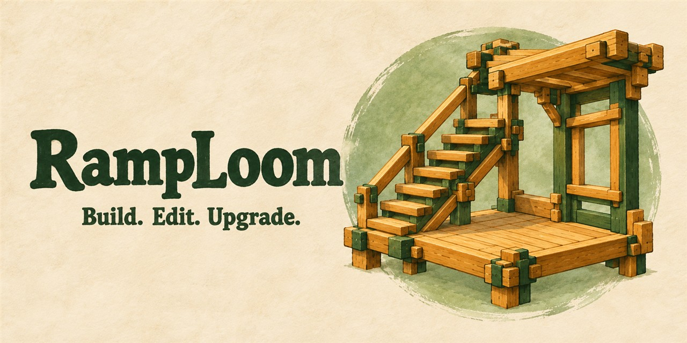
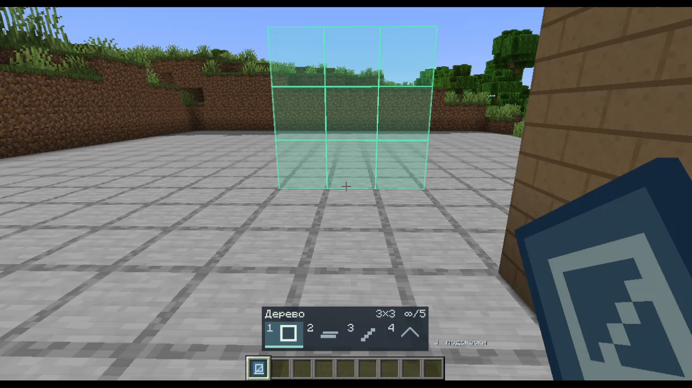
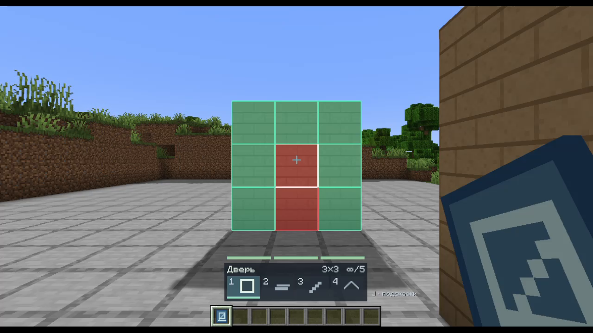
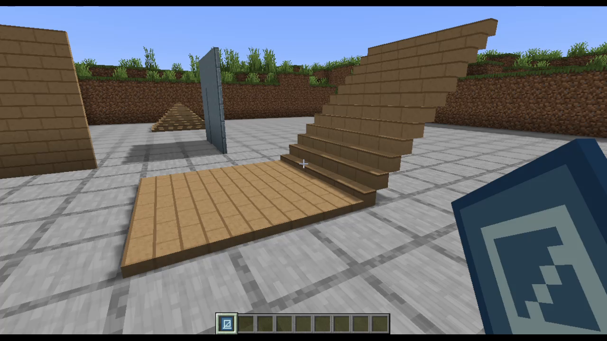
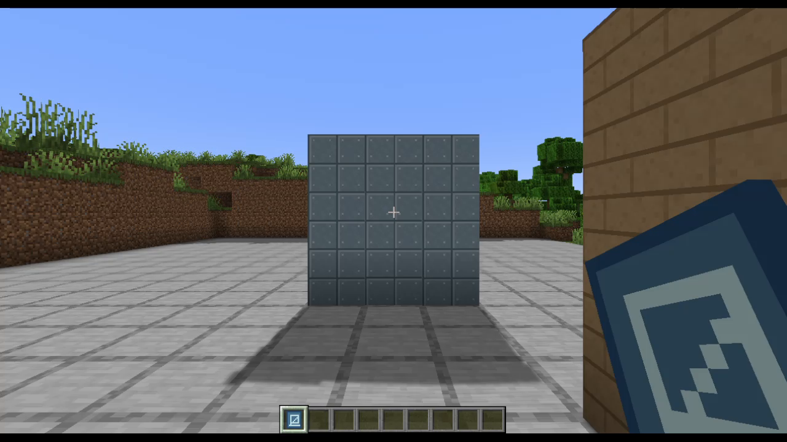
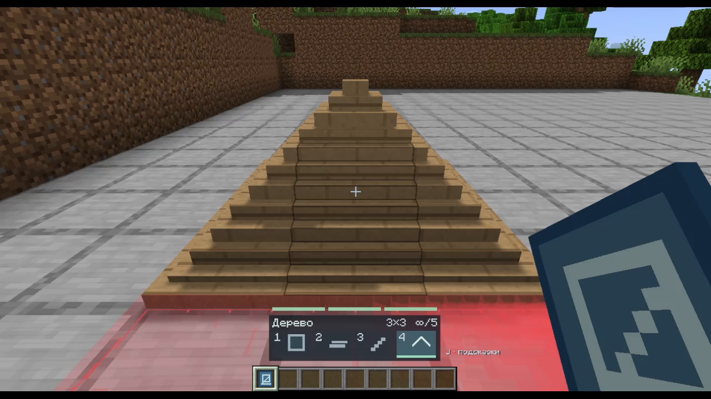
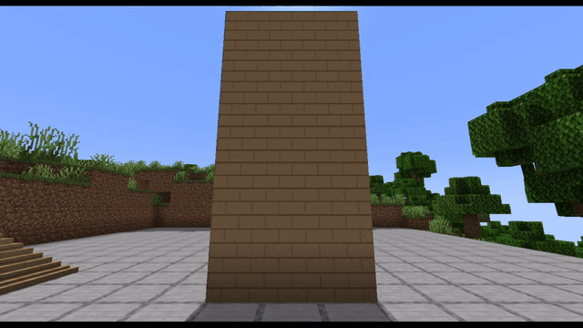
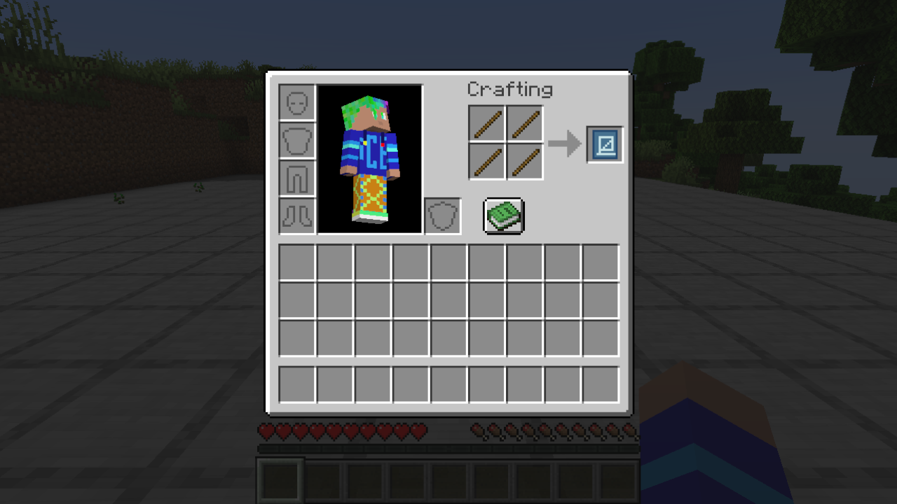

# RampLoom

**Build, edit and upgrade modular structures in Minecraft.**

Place walls, floors, ramps and roofs using a blueprint. Edit their shapes,
upgrade wood to stone and metal, and watch structures collapse when their last
foundation is removed.

**Latest download: [0.6.2 · Public beta](https://github.com/01egendarY/RampLoom/releases/tag/v0.6.2)** ·
[All versions](https://github.com/01egendarY/RampLoom/releases) · [Changelog](CHANGELOG.md)

## What's new in 0.6.2

- Shared **3×3 grid**: turn and place four walls around your cell without lining up individual blocks.
- **3×1, 3×2 and 3×3** pieces; aim to choose the strip or pair of strips inside a cell.
- Expand narrow pieces in the editor for materials. Resets restore the purchased size and strip positions.
- Mixed-material intersections no longer flicker, and previews no longer make ocean water disappear.

See the [changes since 0.5.2](CHANGELOG.md#062--2026-10-21) and [editing guide](docs/controls.md#editing-and-expansion).

## Requirements

| Requirement | Supported |
|---|---|
| Minecraft | Java Edition 1.21.1 |
| Loader | [Fabric Loader](https://fabricmc.net/use/installer/), 0.16.0 or later |
| Dependency | [Fabric API](https://modrinth.com/mod/fabric-api), compatible with 1.21.1 |
| Java | 21 |
| Installation | Client and server; singleplayer runs the server internally |

Sodium and Iris are optional. Shaders are not required. Forge, NeoForge, Quilt
and other Minecraft versions are not advertised as supported.

## Start building

1. Put the playable RampLoom JAR and Fabric API in your Fabric instance's `mods`
   folder. Keep one version of RampLoom installed.
2. Craft a **Blueprint from four sticks in a 2×2 square**.
3. Hold it in your main hand, choose a piece with **1–4** and **left-click** to
   place. Hold the button for continuous building.

Download `ramploom-0.6.2.jar` from the release. GitHub's automatic **Source code**
archives contain this showcase's documents and images, not the playable mod.

Pieces are available in **3×3, 3×1 and 3×2** sizes. Their initial material costs are
respectively **5, 2 and 3**: `ceil(area / 2)`. Walls use height × width; the other
pieces use forward length × width. Creative mode consumes no resources.

For multiplayer, update RampLoom on **every client and the server** to the same
version. Back up worlds before upgrading from 0.5.2. Existing structures keep
their positions; old 2×2 and 2×1 pieces remain readable but cannot be newly placed.
Do not reopen worlds saved with 0.6.x using an older mod version.

## Main features

- Four pieces with shared rendering, selection and collision geometry.
- Transparent green/red previews and shared 3×3 placement cells.
- Wall/floor edits, connected ramp patterns and editable roof corners.
- Paid width expansion with persistent purchased size and free shape resets.
- Interactive doors, with an empty-doorway alternative in settings.
- Wood → stone → metal upgrades, plus repair and tool-sensitive mining.
- Foundation checks and bottom-to-top collapse waves with debris.
- Rebindable controls, compact HUD and English/Russian localization.

See [controls and settings](docs/controls.md) for details.

## In game

**46-second gameplay showcase** — actual RampLoom 0.5.2 gameplay without shaders: crafting, all four pieces,
several edits, interactive doors, upgrades and cascading collapse. Silent, 720p60.

The video and gallery below were recorded in 0.5.2. The current version adds the
shared grid and editor expansion described above.

https://github.com/user-attachments/assets/870a4de9-d7c6-4d67-bc73-f82c82626eb1

[Download the video (MP4, 8.7 MB)](https://github.com/01egendarY/RampLoom/releases/download/v0.5.2/ramploom-showcase-v2-github-720p60.mp4).

| Placement preview | Wall editing |
|---|---|
|  |  |

| Floor and ramp | Upgraded metal wall |
|---|---|
|  |  |

The fourth piece is a cone-shaped roof:

Removing the lower wall also destroys the upper wall that depended on it.

## Craft a blueprint

Four sticks in a 2×2 square produce one Blueprint. This is a screenshot of the
recipe running in Minecraft with RampLoom 0.5.2.

## Beta status

Back up worlds before updates. Multiplayer latency, large constructions and
varied shader packs need more testing. This mod adapts fast building to Minecraft;
it does not promise exact parity with another game.

The public repository contains documentation, branding and approved gameplay
media. Source code remains private. Free play, server use and inclusion of the
unmodified JAR in modpacks are allowed under the [binary license](LICENSE.txt).

Found a problem? [Open an issue](https://github.com/01egendarY/RampLoom/issues/new)
with your Minecraft, Fabric and RampLoom versions, reproduction steps and a
relevant crash report if available. Remove personal information before uploading logs.

Branding is original AI-assisted illustrative artwork, not a gameplay screenshot.
